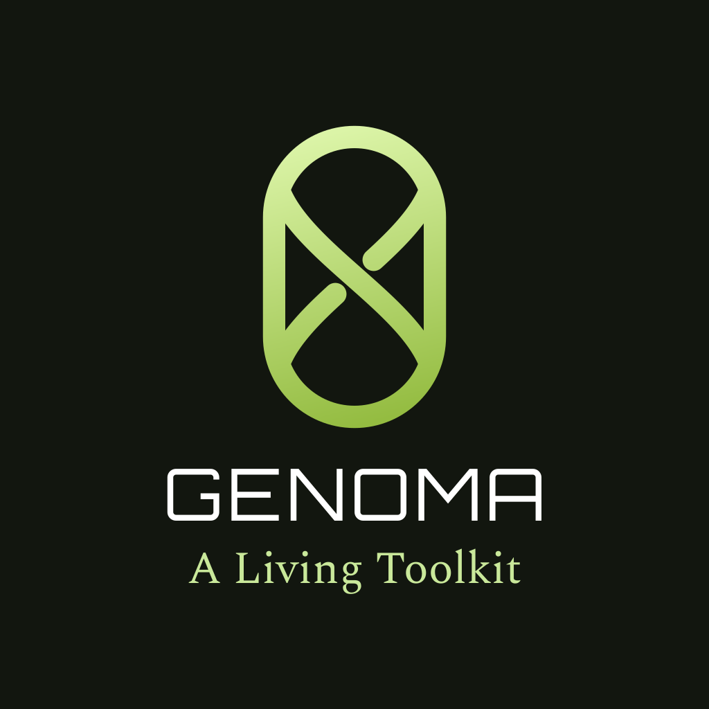

<h1 align="center">
  
</h1>

A Wayland shell toolkit in Rust. Interfaces are written in Luau and reloaded
while they run.

Genoma opens layer surfaces on the compositor, draws them on the GPU with
distance-field primitives, feeds them the system's state as reactive signals,
and reloads them when their files change. It was built for
[Bioma](https://github.com/AkusenArcade/Bioma), and for what Bioma could not
afford on Quickshell: shapes that bud and grow, particles, and depth
transitions. **At rest it costs nothing.** A surface where no value changes
requests no frame, runs no timer and evaluates no binding.

**Status:** 0.1, young. Bioma runs on it whole: its shell, its lock screen
and its greeter. Other shells can be written on it today (see
[`examples/bar`](examples/bar/shell.luau)), but the API is still shaped by
Bioma's needs and will change between minor versions. Changes are listed in
[`CHANGELOG.md`](CHANGELOG.md). The design is in
[`docs/genoma-prd.md`](docs/genoma-prd.md).

## Installing

- **Arch:** `genoma` from the AUR, which installs `/usr/bin/genoma`.
- **From source:** Rust stable, `clang` (for the PipeWire bindings), a
  Vulkan driver, and the `wayland`, `libxkbcommon`, `libpipewire` and `pam`
  libraries. Then:

  ```sh
  cargo build --release -p genoma
  ```

It runs on Wayland compositors with `wlr-layer-shell`. Blur behind surfaces
needs `ext-background-effect-v1`, as niri 26.04 has it. Workspaces and
windows come from the compositor's own IPC: `@genoma/compositor` reads niri,
Hyprland (0.57, configured in Lua or hyprlang) and Umbriel, whichever it
finds running. On other compositors the rest of the toolkit works, and
requiring that service fails (`pcall` it to run anywhere).

## A first shell

```sh
GENOMA_OUTPUT=DP-1 genoma examples/bar
```

[`examples/bar`](examples/bar/shell.luau) is a classic top bar in about 200
lines: workspaces, the focused window's title, CPU, memory, volume (wheel to
change, click to mute), battery, and the time, which opens the date in a
popup. Edit `shell.luau` while it
runs and the bar reloads; values kept with `g.state` survive the reload. An
error keeps the last good tree on screen and is logged.

The other pieces of a desktop are examples too, each a page or two:
[`launcher`](examples/launcher/shell.luau) (applications found and
started), [`dock`](examples/dock/shell.luau) (pinned and running, on niri,
Hyprland or Umbriel), [`notifications`](examples/notifications/shell.luau)
(a notification centre, Genoma serving the bus name),
[`osd`](examples/osd/shell.luau) (volume, and `genoma ipc osd show`),
[`lock`](examples/lock/shell.luau) (ext-session-lock and PAM, its own PAM
file beside it), [`prompt`](examples/prompt/shell.luau) and
[`list`](examples/list/shell.luau). [`kit`](examples/kit/shell.luau),
[`shapes`](examples/shapes/shell.luau),
[`effects`](examples/effects/shell.luau), [`blur`](examples/blur/shell.luau)
and [`inspector`](examples/inspector/shell.luau) show the toolkit itself.

An interface is a directory with a `shell.luau` that returns one or more
surfaces:

```luau
local g = require("@genoma")
local clock = require("@genoma/clock")

g.timing {
    reflow = { duration = 0.2, curve = { 0.2, 0.0, 0.0, 1.0 } },
}

return g.surface {
    anchor = "top",
    margin = { top = 12 },
    g.capsule {
        height = 36,
        padding_x = 16,
        fill = "#16181ded",
        g.text {
            size = 14,
            color = "#d8dee9",
            -- A function is a binding: it re-runs when what it reads changes.
            text = function() return string.format("%02d:%02d", clock.hour, clock.minute) end,
        },
    },
}
```

### Concepts

- **Nodes:** `g.box` lays out, `g.capsule` is a box that draws (fill, rim,
  shadow, linear/radial/conic gradients, radius, blur), and there are also `g.text`, `g.icon`,
  `g.image`, `g.shader` and particle emitters. `g.each` is a keyed list.
  `g.list` is one that scrolls and mounts only the rows in view.
  `g.path` draws any outline: `d` (SVG path data) or `points` (a polygon),
  filled with `fill`, stroked with `color` and `stroke`, with `join`,
  `cap`, `dash` and `even_odd`. It is drawn at the exact pixel size, and
  takes its outline's size unless given one.
- **Shaders:** `g.shader { src = "field.wgsl", values = … }` draws a
  rectangle whose every pixel is your `fn shade(p: vec2<f32>) ->
  vec4<f32>`, fed `shader.size`, `shader.scale`, `shader.time` (with
  `clock = true`), `shader.pointer` (x, y from the node's corner; z 1 over
  the surface; w 1 while a button is held: a shader that reads it takes the
  pointer and is drawn again as it moves) and `value(i)`, the numbers
  bound: a theme's palette goes there. Every shader also has
  Genoma's library, prefixed `g_`: noise (`g_noise`, `g_noise3`,
  `g_simplex`, `g_worley`, `g_fbm`, `g_fbm3`, `g_value_noise`,
  `g_hash`…), distance fields (`g_smin`, `g_smax`, `g_sd_circle`,
  `g_sd_box`, `g_sd_rounded_box`, `g_sd_segment`, `g_cover` for an
  antialiased edge) and colour (`g_rgba`, `g_premul`, `g_over`); see
  `crates/genoma-render/src/shaders/library.wgsl`. A shader with
  `backdrop = true` reads what its surface drew under it with
  `g_backdrop(p)`, a little beyond its edges too. Six effects come built
  in, `src = "genoma:noise"` (`ripple`, `dissolve`, `vignette`, `grain`,
  and `glass`, a pane that bends what is under it at its rim), and `require("@genoma/kit/effects")` gives them as nodes with
  named parameters. `GENOMA_SHADER=file.wgsl cargo test -p genoma-render
  shader_file` checks a shader without drawing it. See `examples/effects`.
- **Blur:** `blur_radius = 6` draws a node and everything in it blurred,
  after depth has turned it, the spread in logical units as CSS's
  `blur()`. At 0, the default, nothing is done. The subtree is drawn into
  a texture of its own and blurred there (halved first for a wide
  spread); a radius and a content at rest are blurred once and kept, a
  moving radius is blurred each frame. It animates with `transition`. See
  `examples/blur`. `backdrop_blur = 10` is frosted glass: what the
  surface drew under a flat node, blurred, shows through it inside its
  shape, kept at rest as well. Other programs' windows are the
  compositor's to blur (`blur = true`, through `ext-background-effect`).
- **Shapes drawn as one:** a capsule with `combine_with = "id"` is drawn
  as one shape with the capsule of that id, by their distance fields:
  `combine = "union"` (a neck grows between them as `combine_soft`
  says: metaballs), `"subtract"` (a bite, a moon) or `"intersect"` (a
  lens). The named capsule lends its outline; give it no fill unless it
  should be drawn too. See `examples/shapes`.
  The [API reference](docs/reference.md) lists every property, function
  and service. `genoma types ~/.local/share/genoma/types` writes the whole
  API as Luau types, the kit's sources beside them; point `@genoma` at
  that directory in your interface's `.luaurc` (`{ "aliases": { "genoma":
  "…" } }`) and luau-lsp completes and checks every `require("@genoma/…")`.
- **Bindings:** any property can be a function. It is re-evaluated only when
  a signal it read changes. `g.signal`, `g.computed`, `g.effect` and
  `g.watch` make your own signals.
- **Timing:** every duration has a name in `g.timing { … }`. A literal
  duration in an interface is rejected at load. A transition names the
  timing to use, so retiming a shell is one table.
- **Input:** `on_click`, `on_wheel`, `on_drag`, `on_key`, `on_hover`,
  `on_fling` and others. The input region follows the nodes that take input.
  `on_wheel(dx, dy, steps)` is told whether the movement came in a wheel's
  steps or a touchpad's distance.
- **Popups inside a tree:** a `g.popup` written as a child of a node is
  taken out at load and becomes a surface of its own, anchored to that
  node (which is given an id if it has none): a menu is written inside the
  button that opens it. Popups written there may hold popups (a submenu).
  One inside a `g.each` row or a function of the output is refused; write
  it beside the surfaces with an `anchor` instead.
- **The kit:** `require("@genoma/kit")` gives `button`, `toggle`,
  `slider`, `progress`, `menu`, `dropdown`, `tooltip`, `list`, `tabs` and
  `dialog`, built on the nodes above and drawn in a neutral look of their
  own. A dialog is a surface, returned beside the others.
  `kit.theme.set { accent = "#e6b062", radius = 10 }` changes it for every
  component on screen, the colours moving there. Each is also
  `require("@genoma/kit/button")` and so on, and the sources are in
  [`kit/`](kit). Its times are `kit_quick`, `kit_move` and `kit_open`,
  defined with `g.timing_default`, so a shell retimes them with
  `g.timing` before or after requiring the kit. See `examples/kit`.
- **Keyboard:** a node with `navigate = true` is walked by the keyboard
  once its surface has the keys: Tab and Shift+Tab, or the arrows, move
  the focus among its buttons and sliders, ringed in `focus_color`; a
  focused slider takes Left and Right; Return and space press; Escape lets
  the focus go. Other keys reach the focused node and its ancestors'
  `on_key`. A press of the pointer takes the ring away. Without
  `navigate`, keys go to what catches, as `g.focus_move` and
  `g.focus_press` walk it.
- **Inspector:** `GENOMA_IPC=inspector GENOMA_INSPECT=<name> genoma
  examples/inspector` opens a panel beside another running interface (its
  `GENOMA_IPC`, `genoma` by default): its surfaces, its tree of nodes as
  they are, and the chosen node's properties, outlined on screen where it
  is drawn. It is a Genoma interface itself, on `genoma ipc genoma tree`
  and `highlight`.
- **Long lists:** `g.list { items = …, key = …, row = …, row_height = 28,
  height = 336, reveal = … }` takes `g.each`'s three functions, but mounts
  only the rows in view and a few beyond, so thousands of items cost what a
  dozen do. Every row is `row_height` tall. The list needs a height of its
  own (`height`, or `grow` in a bounded parent): its rows do not size it.
  It scrolls by itself: a wheel step is three rows, glided to; a touchpad
  moves it as the fingers do and flings it when they lift. `reveal`, a
  row's place from 1, brings that row into view the least way, which is
  what keyboard selection wants. `on_scroll(offset, room)` reports where it
  is, for a scroll bar of your own. See `examples/list`.
- **Fields:** `g.field { text = …, on_change = …, on_submit = …, focused = … }`
  is a line to type into: caret and selection by key and by pointer
  (double-click a word, triple-click the line), word moves, undo and redo,
  Ctrl+C/X/V through the clipboard, `secret` for passwords, and input methods
  (`text-input-v3`) for scripts typed by composition. Keep its text in a
  signal written by `on_change`. A surface takes the keyboard while a node
  catches, or as its `keyboard` says (`"on_demand"` for a bar with a search
  field, `"exclusive"`). See `examples/prompt`.
- **Popups:** `g.popup { anchor = "clock", side = "bottom", align = "end",
  present = …, on_dismiss = … }` opens beside the node with `id = "clock"`
  on another surface, over everything. The compositor turns it to the other
  side or slides it along when it would leave the screen. Opened by a press
  or a key, it takes the keyboard (keys reach a `catch` node's `on_key`) and
  a press elsewhere closes it, calling `on_dismiss`. `anchor` may be a
  function, so one menu serves every item of a tray.
- **Living layer:** threads that grow between nodes, budding panels joined by
  a narrowing neck, springs, and 3D tilt and depth (`rotate_x`, `rotate_y`,
  `depth`, `perspective`). See `examples/living`, `examples/budding`.

### Services

`require("@genoma/<name>")` returns one shared object per domain. It starts on
first use, and every field is a signal.

| Service | What it gives |
|---|---|
| `clock` | hour, minute, second |
| `vitals` | CPU, memory, GPU load and clocks |
| `power` | battery (UPower), power profiles |
| `audio` | PipeWire nodes, links, defaults, volume and mute |
| `media` | MPRIS players, metadata, position, controls |
| `network` | NetworkManager devices, Wi-Fi networks, join and forget |
| `bluetooth` | BlueZ adapter and devices |
| `notifications` | an `org.freedesktop.Notifications` server |
| `tray` | StatusNotifierItem with DBusMenu |
| `polkit` | a polkit authentication agent |
| `idle`, `lock` | idle notification, session lock |
| `compositor` | workspaces, windows, the focused one, and switching between them: niri, Hyprland or Umbriel |
| `niri` | the same from niri alone, with niri's numeric ids (niri IPC); kept for shells written against it |
| `toplevels` | windows through `ext-foreign-toplevel-list` |
| `clipboard` | every copy's types and text, set, save to a file, clear (`ext-data-control`) |
| `spectrum` | the sound as 64 bands a channel, captured (`genoma spectrum`, PipeWire) only while held: for a visualiser, or a shader's values |
| `session` | logind: suspend, hibernate, reboot, power off, what is allowed, the moment before sleep, lock requests, inhibitors held and listed |
| `apps` | the applications the menu offers: search ranked by use, launch with actions and files, find by window class (desktop entries) |

Anything else is built from `g.process`, `g.dbus`, `g.socket`, `g.file` and
`g.timer`, in Luau. `g.pam` and `g.greetd` serve lock screens and greeters.

## Command line

| Command | |
|---|---|
| `genoma <dir> [entry]` | run the interface in `<dir>`, from `shell.luau` or another entry file |
| `genoma types [dir]` | print the API as Luau types, or write them to `dir` for luau-lsp |
| `genoma reference` | print the API reference in Markdown (`docs/reference.md`) |
| `genoma probe` | print every service's signals as they change, without UI |
| `genoma ipc <target> <function> [args…]` | call into a running interface (`g.ipc`) |
| `genoma ipc genoma tree` | every surface and node of a running interface, as JSON; `genoma ipc genoma highlight <surface> <node>` outlines one, `… highlight none` |
| `genoma pam <service> [dir]` | one PAM authentication, from the terminal |
| `genoma polkit-test` | the polkit agent against one process of its own |

Environment: `GENOMA_OUTPUT` picks the output for a test run,
`GENOMA_IPC` names the IPC socket, and `GENOMA_LOG=info,genoma=debug` logs
frames and the GPUs on offer.

## Versioning

Genoma follows semantic versioning. Before 1.0, a **minor** version
(0.1 → 0.2) may break interfaces, and a **patch** version (0.1.1 → 0.1.2)
does not. Every change an interface could notice is in
[`CHANGELOG.md`](CHANGELOG.md). A breaking change is marked **Breaking** and
says what to change.

## Licence

GPL-3.0-or-later. See `LICENSE`.
